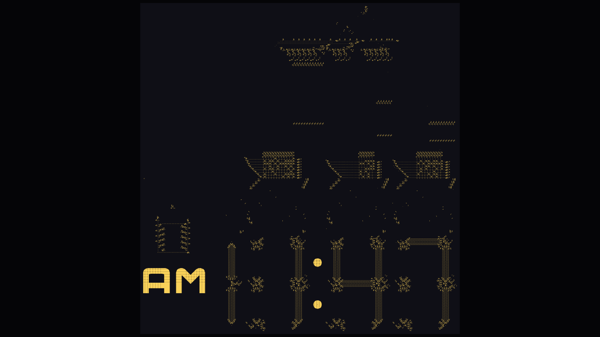

# 01 — Game of Life

> Conway's Game of Life: four simple rules on a grid of cells, and out come gliders, oscillators and chaos. Built twice — once on the CPU, once as a GPU compute shader — to see the difference.

**Started:** 2026-11-04 · **Finished:** YYYY-MM-DD · **Time spent:** ~X hours

## The algorithm

(Write this in your own words once it's working.)

Hint: every cell looks at its 8 neighbors. Live with 2–3 neighbors → survives. Dead with exactly 3 → born. Everything else → dead. The whole grid updates at the same time, which is why the code needs two grids (read the old one, write the new one, then swap).

## Two versions

| | CPU (`GameOfLife.cs`) | GPU (`GPU/GpuLife.cs` + `GPU/Life.compute`) |
|---|---|---|
| Where the rules run | C#, one cell at a time in a loop | HLSL compute shader, every cell in parallel |
| Grid storage | `bool[,]` arrays | `RenderTexture`s (r = alive, g = trail) |
| Double buffering | swap two arrays | ping-pong two textures |
| Default size | 160 × 90 | 1024 × 576 |
| Speed control | steps per second | steps per frame |

## Controls (both versions)

| Input | Action |
|-------|--------|
| Space | Play / pause |
| N | Step one generation (while paused) |
| R | Random fill |
| C | Clear |
| + / − | Faster / slower |
| W | Toggle wrapping edges |
| Left mouse | Draw cells |
| Right mouse | Erase cells |

## Setup

1. Unity Hub → New project → **Universal 2D** (Unity 6), named `01-game-of-life`.
2. Copy the `Assets/Scripts/` folder into the project.
3. Make two scenes (File → New Scene, save in `Assets/Scenes/`):
   - **CPU.unity** — Create Empty at (0, 0, 0), add `GameOfLife`. Press Play; the camera fits itself.
   - **GPU.unity** — Create Empty, add `GpuLife`, drag `Life.compute` into its **Shader** field. Press Play; it draws over the whole screen.

Grid size, speed, colors, brush size and fill density are all in the Inspector.

## Benchmark — CPU vs GPU

Fill this in on your own machine. Try the same grid sizes in both versions and note the FPS.

| Grid | Cells | CPU FPS | GPU FPS |
|------|------:|--------:|--------:|
| 160 × 90 | 14,400 | | |
| 512 × 288 | 147,456 | | |
| 1024 × 576 | 589,824 | | |
| 2048 × 1152 | 2,359,296 | | |
| 4096 × 2304 | 9,437,184 | — | |

My machine: (CPU / GPU / RAM)

What I noticed:

## Bonus — a digital clock built entirely out of Life

A 7168 × 7434 Life pattern (~330,000 live cells) that *is* a working digital clock. Nothing is drawn on top: the 7-segment digits are streams of gliders, and the circuitry above them (a timebase, counters, latches and lookup tables, all made of gliders and oscillators) computes which segments to light. My GPU engine just runs the rules on it.

- Original idea: a [Code Golf challenge](https://codegolf.stackexchange.com/questions/88783/build-a-digital-clock-in-conways-game-of-life), won by user "dim" ([Hackaday write-up](https://hackaday.com/2017/03/11/a-clock-created-with-conways-life/)).
- The pattern I run: **clockMini.rle**, a smaller synchronized version by Vladan Majerech — [VladanMajerech/ConwayLifeDigitalClocks](https://github.com/VladanMajerech/ConwayLifeDigitalClocks).

**Measured:** one displayed minute = **2,880 generations**, so **48 generations/second = real time**. It starts at `AM 1:46`.

### Setup

1. New scene **Clock.unity** → Create Empty → add `LifeClock`.
2. Press Play. On the first run it downloads `clockMini.rle` (~800 KB) from Vladan's repo and caches it in Unity's persistent data folder, so later runs start instantly and work offline. The shader loads itself from `Clock/Resources/`.
3. Needs a GPU with ~250 MB free VRAM.

To use a different pattern, drop any B3/S23 `.rle` into `Assets/StreamingAssets/` and set **Pattern File** in the Inspector. A file there always takes priority over the download.

| Input | Action |
|-------|--------|
| Space | Play / pause |
| N | Step one generation (while paused) |
| + / − | Double / halve speed |
| R | Back to real-time speed |
| F | Fit whole pattern on screen |
| Scroll | Zoom toward the mouse |
| Left / middle drag | Pan |

### How the clock viewer differs from the GPU Life version

- **Pattern loading:** `RleLoader.cs` parses the RLE format (`2bo$3o!` style) into bytes, uploads them once as an 8-bit texture, and a `Load` kernel copies them into the simulation texture.
- **Memory:** state is `RG16` (2 bytes per cell) instead of `ARGB32` (4 bytes). At 53 million cells that's ~105 MB per texture instead of ~210 MB.
- **Screen-sized display:** the `View` kernel works per screen pixel, not per cell. When zoomed out, each pixel samples a block of cells and shades by density, so thin glider streams don't flicker out of view.
- **Edges:** no wrapping; outside the grid counts as dead.
- **Adaptive speed:** if the frame rate drops below ~30 FPS, it runs fewer generations per frame instead of freezing. The HUD says "GPU-limited" when it can't reach the speed you asked for.

### Verified

Before running it in Unity, the shader logic was checked against [lifelib](https://gitlab.com/apgoucher/lifelib) (a reference Life engine): a line-for-line Python port of `RleLoader` + the `Load` and `Step` kernels was run on the full clock for **3,000 generations** (just over one displayed minute) and matched the reference **cell for cell**, with zero mismatches across all 54 million cells. All 8 kernels in both `.compute` files also compile cleanly with glslang's HLSL front end.

> I didn't find a license on the clock repo, so `clockMini.rle` isn't committed here; it's downloaded at runtime instead. `.gitignore` excludes `*.rle` in StreamingAssets.

## How it's built

**CPU version**
- `GameOfLife.cs` — grid, rules, drawing, input and HUD in one script.
- Draws one `Texture2D` with point filtering (1 pixel per cell) instead of thousands of GameObjects.

**GPU version**
- `Life.compute` — five kernels: `Init` (random fill), `Clear`, `Step` (the rules), `Paint` (brush), `Colorize` (state → colors).
- `GpuLife.cs` — creates the textures, dispatches kernels in 8×8 thread groups, handles input, draws the result with `GUI.DrawTexture`.
- The state never leaves the GPU. Reading it back to C# every frame (e.g. to count the population) would be the slowest part of the whole thing.

**Both:** a trail value makes recently dead cells glow and fade, so you can see motion.

## Journal

### 2026-11-04
Set up the repo. Wrote the CPU version, then the GPU compute shader version — both worked first try.

Found the digital clock built inside Life and wrote a big-pattern viewer for it: RLE loader, 2-byte-per-cell state, zoomable view, auto-download of the pattern, and adaptive speed. Measured the clock: 2,880 generations per displayed minute.

## What broke (and how I fixed it)

- **Problem:**
  **Cause:**
  **Fix:**

## What I learned

-

## If I came back to this

- Pattern stamps (glider, glider gun, pulsar) placed with a key
- Other rule sets (HighLife B36/S23, Seeds B2/S)
- Population graph (GPU: count with `AsyncGPUReadback` so it doesn't stall)
- Zoom and pan on the GPU version

## References

- [Conway's Game of Life — Wikipedia](https://en.wikipedia.org/wiki/Conway%27s_Game_of_Life)
- [LifeWiki](https://conwaylife.com/wiki/) — catalog of known patterns
- [Unity Manual — Compute shaders](https://docs.unity3d.com/Manual/class-ComputeShader.html)
